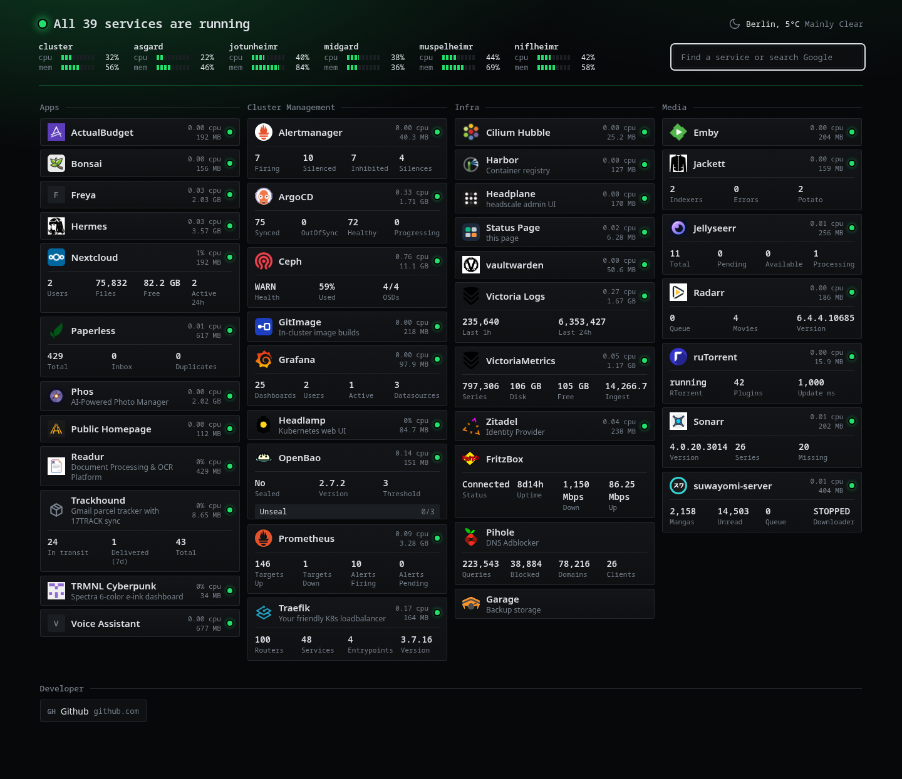

# Hugin

Hugin is a small dashboard for a Kubernetes homelab. It lists your services by reading annotations on Ingresses, shows whether their pods are up, and adds a few numbers from each service's own API.



It is one Rust binary that renders HTML on the server and pushes updates to the browser over server-sent events. On a cluster with about 400 pods and 38 services it uses about 10 MiB of memory and 10 millicores while the page is open.

## Features

- Service discovery from Ingress annotations, and optionally from Traefik `IngressRoute` objects.
- A status dot per service from pod phase, plus CPU and memory of the pods.
- Widgets are sandboxed Lua scripts stored in the cluster as `Widget` resources. None are built in.
- A generator writes the widget for each service: a language model researches the application on the web, explores the live service's API, and hands in a script that is validated against the service.
- Your own widgets, written by hand, take precedence.
- Widget credentials read from Kubernetes Secrets by reference, with RBAC limited to the Secrets you name.
- Header with cluster and node CPU and memory, Open-Meteo weather and a search box.
- Static entries and bookmarks from configuration.
- Upstream APIs are polled only while someone has the page open.
- `/healthz` and Prometheus `/metrics` on a separate port.

## Install

```bash
helm install hugin oci://ghcr.io/diverofdark/charts/hugin \
  --namespace hugin --create-namespace \
  --set ingress.enabled=true \
  --set 'ingress.hosts[0].host=status.example.com' \
  --set 'ingress.hosts[0].paths[0].path=/' \
  --set 'ingress.hosts[0].paths[0].pathType=Prefix'
```

The chart also lives in this repository under `charts/hugin`, which is what an Argo CD Application can point at.

The dashboard needs [metrics-server](https://github.com/kubernetes-sigs/metrics-server) for CPU and memory figures. Without it the status dots still work.

## Documentation

The full documentation is at **<https://diverofdark.github.io/hugin/>**:

- [Services](https://diverofdark.github.io/hugin/services.html): the annotations, status and static entries.
- [Widgets](https://diverofdark.github.io/hugin/widgets.html), [the generator](https://diverofdark.github.io/hugin/generator.html) and the [script API](https://diverofdark.github.io/hugin/widget-api.html).
- [Credentials from Secrets](https://diverofdark.github.io/hugin/credentials.html) and [permissions](https://diverofdark.github.io/hugin/permissions.html).
- [Configuration](https://diverofdark.github.io/hugin/configuration.html), [endpoints and metrics](https://diverofdark.github.io/hugin/endpoints.html).

Its source is in [`docs/`](docs/SUMMARY.md), built with [mdBook](https://rust-lang.github.io/mdBook/): `mdbook serve` shows it locally.

## Development

```bash
cargo test
cargo run -- --config ./config.json --bind 127.0.0.1:8080 --ops-bind 127.0.0.1:8081
```

With a kubeconfig, Hugin runs against that cluster. `--no-kube` runs without a cluster and shows only static services.

The Lua sandbox is in `src/widgets/lua.rs`, the generator in `src/generator.rs`. Both reach the network only through the `Http` trait, which the tests replace: the sandbox tests cover the limits and the handling of credentials, and the generator tests drive the whole loop with a scripted model.
