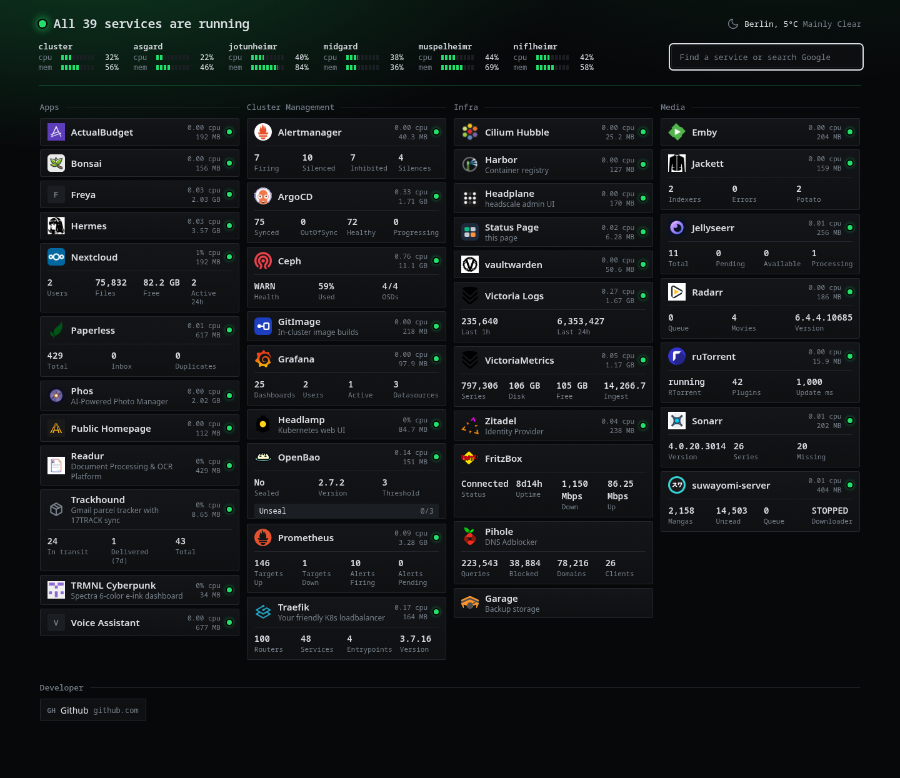

# Hugin

Hugin is a small dashboard for a Kubernetes homelab. It lists your services by reading annotations on Ingresses, shows whether their pods are up, and adds a few numbers from each service's own API.

It is one Rust binary that renders HTML on the server and pushes updates to the browser over server-sent events. On a cluster with about 400 pods and 38 services it uses about 10 MiB of memory and 10 millicores while the page is open.

## Features

- Service discovery from Ingress annotations, and optionally from Traefik `IngressRoute` objects.
- A light per service: green when its pods are up and its page answers. Plus CPU and memory of the pods.
- Widgets are sandboxed Lua scripts stored in the cluster as `Widget` resources. None are built in.
- A generator writes the widget for each service: a language model researches the application on the web, explores the live service's API, and hands in a script that is validated against the service.
- A widget value can report a problem, which colours the card and the page.
- Your own widgets, written by hand, take precedence.
- Widget credentials read from Kubernetes Secrets by reference, with RBAC limited to the Secrets you name.
- Header with cluster and node CPU and memory, Open-Meteo weather and a search box.
- Static entries and bookmarks from configuration.
- Upstream APIs are polled only while someone has the page open.
- `/healthz` and Prometheus `/metrics` on a separate port.
